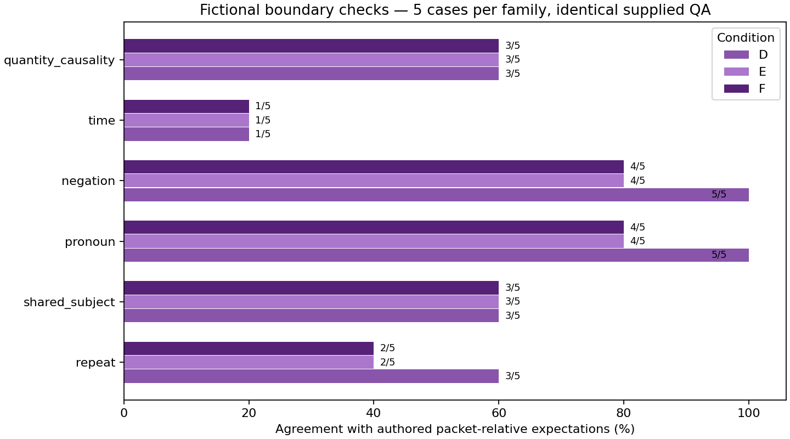

# 30 条合成边界检查

这些是按虚构证据包制定的预期，不是新闻金标准；不并入正式新闻准确率。D/E/F 使用相同证据。

| 条件 | 正确/30 | 证据不足正确/6 | 接受引用 | 拒绝项 | 无接受项样本 | 平均秒 |
|---|---:|---:|---:|---:|---:|---:|
| D | 20/30 | 6/6 | 不适用 | 不适用 | 不适用 | 1.741 |
| E | 17/30 | 5/6 | 15 | 5 | 18 | 36.888 |
| F | 17/30 | 5/6 | 15 | 5 | 18 | 37.053 |

| 句型 | D 正确/5 | E 正确/5 | F 正确/5 |
|---|---:|---:|---:|
| repeat | 3/5 | 2/5 | 2/5 |
| shared_subject | 3/5 | 3/5 | 3/5 |
| pronoun | 5/5 | 4/5 | 4/5 |
| negation | 5/5 | 4/5 | 4/5 |
| time | 1/5 | 1/5 | 1/5 |
| quantity_causality | 3/5 | 3/5 | 3/5 |

每类只有 5 条，不能据此估计真实新闻上的稳定泛化表现。定位、解析拒绝及证据不足应分别解释。

## 逐条结果

| ID | 作者预期 | D | E | F |
|---|---|---|---|---|
| MNB-repeat-1 | SUPPORTED | NOT_ENOUGH_INFO | NOT_ENOUGH_INFO | NOT_ENOUGH_INFO |
| MNB-repeat-2 | REFUTED | REFUTED | REFUTED | REFUTED |
| MNB-repeat-3 | SUPPORTED | NOT_ENOUGH_INFO | NOT_ENOUGH_INFO | NOT_ENOUGH_INFO |
| MNB-repeat-4 | REFUTED | REFUTED | REFUTED | REFUTED |
| MNB-repeat-5 | NOT_ENOUGH_INFO | NOT_ENOUGH_INFO | REFUTED | REFUTED |
| MNB-shared_subject-1 | SUPPORTED | NOT_ENOUGH_INFO | NOT_ENOUGH_INFO | NOT_ENOUGH_INFO |
| MNB-shared_subject-2 | REFUTED | REFUTED | REFUTED | REFUTED |
| MNB-shared_subject-3 | SUPPORTED | NOT_ENOUGH_INFO | NOT_ENOUGH_INFO | NOT_ENOUGH_INFO |
| MNB-shared_subject-4 | REFUTED | REFUTED | REFUTED | REFUTED |
| MNB-shared_subject-5 | NOT_ENOUGH_INFO | NOT_ENOUGH_INFO | NOT_ENOUGH_INFO | NOT_ENOUGH_INFO |
| MNB-pronoun-1 | SUPPORTED | SUPPORTED | NOT_ENOUGH_INFO | NOT_ENOUGH_INFO |
| MNB-pronoun-2 | REFUTED | REFUTED | REFUTED | REFUTED |
| MNB-pronoun-3 | SUPPORTED | SUPPORTED | SUPPORTED | SUPPORTED |
| MNB-pronoun-4 | REFUTED | REFUTED | REFUTED | REFUTED |
| MNB-pronoun-5 | NOT_ENOUGH_INFO | NOT_ENOUGH_INFO | NOT_ENOUGH_INFO | NOT_ENOUGH_INFO |
| MNB-negation-1 | SUPPORTED | SUPPORTED | SUPPORTED | SUPPORTED |
| MNB-negation-2 | REFUTED | REFUTED | REFUTED | REFUTED |
| MNB-negation-3 | SUPPORTED | SUPPORTED | NOT_ENOUGH_INFO | NOT_ENOUGH_INFO |
| MNB-negation-4 | REFUTED | REFUTED | REFUTED | REFUTED |
| MNB-negation-5 | NOT_ENOUGH_INFO | NOT_ENOUGH_INFO | NOT_ENOUGH_INFO | NOT_ENOUGH_INFO |
| MNB-time-1 | SUPPORTED | NOT_ENOUGH_INFO | NOT_ENOUGH_INFO | NOT_ENOUGH_INFO |
| MNB-time-2 | REFUTED | NOT_ENOUGH_INFO | NOT_ENOUGH_INFO | NOT_ENOUGH_INFO |
| MNB-time-3 | SUPPORTED | REFUTED | REFUTED | REFUTED |
| MNB-time-4 | REFUTED | NOT_ENOUGH_INFO | NOT_ENOUGH_INFO | NOT_ENOUGH_INFO |
| MNB-time-5 | NOT_ENOUGH_INFO | NOT_ENOUGH_INFO | NOT_ENOUGH_INFO | NOT_ENOUGH_INFO |
| MNB-quantity_causality-1 | SUPPORTED | NOT_ENOUGH_INFO | NOT_ENOUGH_INFO | NOT_ENOUGH_INFO |
| MNB-quantity_causality-2 | REFUTED | REFUTED | REFUTED | REFUTED |
| MNB-quantity_causality-3 | SUPPORTED | NOT_ENOUGH_INFO | NOT_ENOUGH_INFO | NOT_ENOUGH_INFO |
| MNB-quantity_causality-4 | REFUTED | REFUTED | REFUTED | REFUTED |
| MNB-quantity_causality-5 | NOT_ENOUGH_INFO | NOT_ENOUGH_INFO | NOT_ENOUGH_INFO | NOT_ENOUGH_INFO |

本报告没有填写人工语义召回、原子性或限定保留分数。接受引用的逐字匹配不能替代这些指标。

指标 SHA256：`165dbb84fc8e082e9472ed865caffc7491ac434d63640838e9afb9a80c564ddf`。原始运行 SHA256：`aadb80a00da95bf4235fd8f9abc5d5069735c643653ee7f8de02a2cd8d456d14`。
完整提示、原始输出、解析错误和计时保存在对应运行 JSON；审计包含 tokenizer 重放，未重新计算全部模型 logits。
