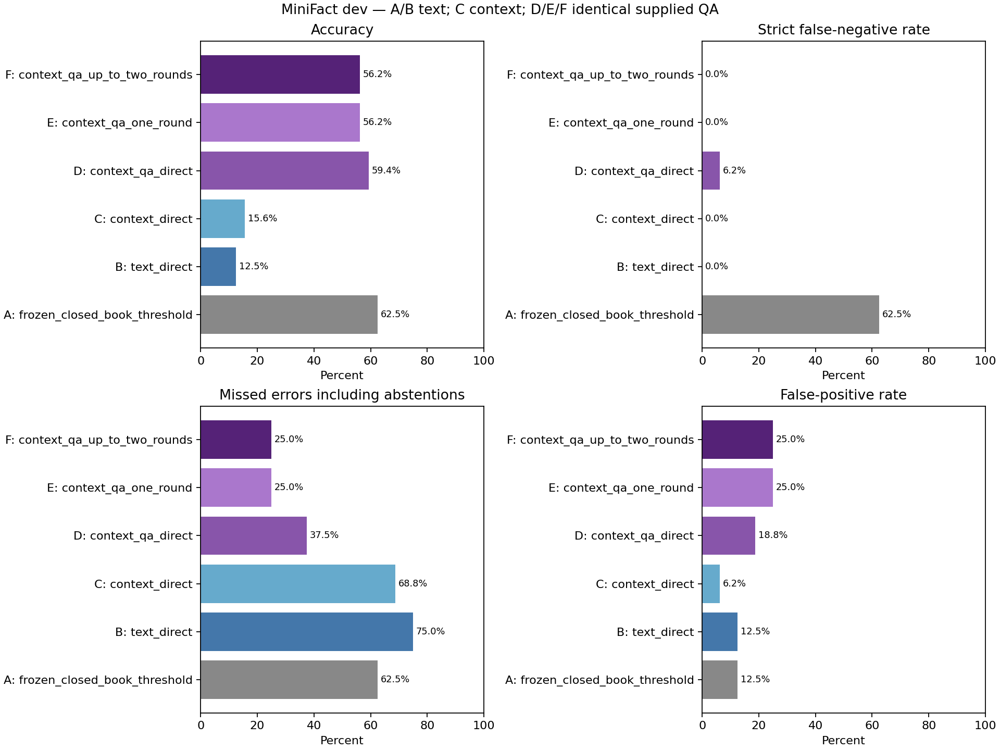
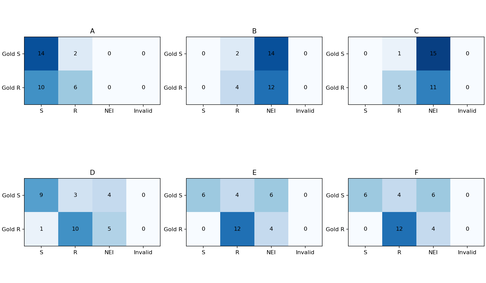
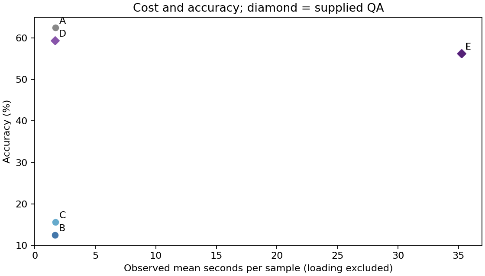

# MiniFact 下一轮评估记录

阶段：`dev`。指标文件 SHA256：`654d89e1c07848df2b4b518a5a5b9298cf035531fec751dce75f1edb4dd6aeea`。

开发集和合成边界用例不能替代正式新闻测试。提供 QA 的条件不是自动联网核查。

| 组别 | 正确/总数 | 准确率 | 严格漏报 | 含弃答未检出 | 误报 | 平均秒 |
|---|---:|---:|---:|---:|---:|---:|
| A | 20/32 | 62.50% | 62.50% | 62.50% | 12.50% | 1.719 |
| B | 4/32 | 12.50% | 0.00% | 75.00% | 12.50% | 1.685 |
| C | 5/32 | 15.62% | 0.00% | 68.75% | 6.25% | 1.715 |
| D | 19/32 | 59.38% | 6.25% | 37.50% | 18.75% | 1.656 |
| E | 18/32 | 56.25% | 0.00% | 25.00% | 25.00% | 35.213 |
| F | 18/32 | 56.25% | 0.00% | 25.00% | 25.00% | 35.270 |

主要比较 F−D：-3.12 个百分点；配对 95% 区间 [-0.15625, 0.09375]（比例单位）。

## 分数与覆盖

| 组别 | 标签平均 logprob | 正误 AUROC | 二分类覆盖 |
|---|---:|---:|---:|
| A | 不适用：候选评分 | 0.42916666666666664 | 100.00% |
| B | -0.2008779477328062 | 0.03571428571428571 | 18.75% |
| C | -0.2181559547316283 | 0.22962962962962963 | 18.75% |
| D | -0.23314484534148505 | 0.8299595141700404 | 71.88% |
| E | -0.13617907462230505 | 0.7380952380952381 | 68.75% |
| F | -0.13617907462230505 | 0.7380952380952381 | 68.75% |

标签 logprob 是每条样本标签 token 均值的算术平均。A 的 AUROC 使用距冻结阈值的绝对 margin；其他组使用实际生成标签均值，不能跨组解释成同一真假概率刻度。

## 验收状态

评估交付完成：**False**；升级默认方法：**False**。

缺少人工语义对齐时不填充语义成绩；位置逐字匹配不代表事实独立或提全。所有分项计数、区间、拒绝、弃答与成本保留在指标 JSON 中。

双角色与直接组计算预算不同。额外轮次的收益不单独证明反馈或 logprob 的因果作用。分数不是校准后的真假概率。

